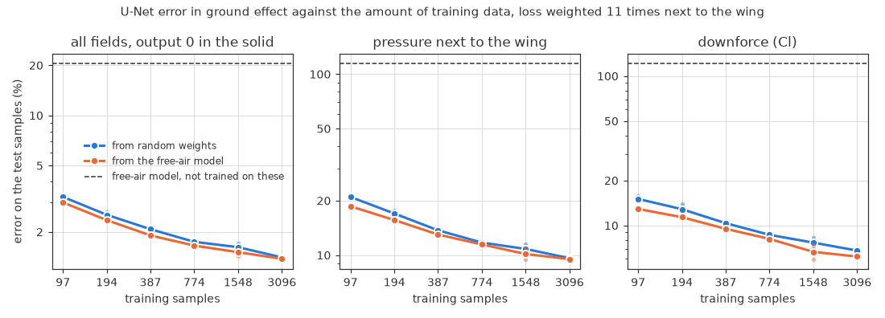

# 10. All the data: the learning curve again

[README](../README.md) · ← [9. Downforce](09-downforce.md) · [11. A new wing](11-naca4412-sweep.md) → · [Workflow](../README.md#workflow)

We trained the U-Net again on 3–100% of all 3,096 training samples, now with
the loss weighted next to the wing ([step 9](09-downforce.md)). With all of
them, the downforce computed from the predicted pressure is off by 6.2% on
the 30 test airfoils, and the field error is 1.4% (the free-air model as it
is: 121% and 20%). Both errors still fall as samples are added. The
weighting matters more with more data: with the plain loss, the downforce
error is 9.9%.

*Words used here: [glossary](glossary.md). References: [list](references.md).*

---

**The data used here.** All 4000 runs of the [dataset](07-dataset.md) gave
3,436 samples: 3,096 for training and 340 for validation. The validation
samples are chosen by a checksum of the file name, so the 78 of
[step 8](08-unet-learning-curve.md) are among them. The test samples are the
same 102 as before, on 30 airfoils that are not in the training data.

**The errors** are those of [step 9](09-downforce.md):
- the field error with the output set to 0 inside the wing and the ground
  (the geometry is an input, so this costs nothing);
- the pressure error in the air cells next to the wing;
- the error of Cl computed from the predicted pressure.

With the error measure of steps 1 and 8, which also counts the output inside
the solid, the field errors with all the samples are 1.70% and 1.65% (with
789 samples and the plain loss, in step 8: 1.81% and 1.96%).

## Learning curve

We trained models on 3.125, 6.25, 12.5, 25, 50 and 100% of the 3,096
training samples (97 to 3,096 samples). Each was trained from random weights
and from the free-air model of Run 3, with 2 seeds and the wall weighting of
step 9 (11 times within 2 cells of the wing). The 24 runs of 80,000
iterations took about 4.5 hours on Kaggle's two Tesla T4 GPUs. Two more runs
with the plain loss, for the comparison below, took about 25 minutes (see
[How to run it](howto.md)).

Test samples, mean of the 2 seeds:

| Training samples | Field error, from random weights | Field error, from the free-air model | Downforce error, from random weights | Downforce error, from the free-air model |
|---|---|---|---|---|
| none (free-air model as it is) | – | 20.4% | – | 121% |
| 97 | 3.25% | 3.01% | 15.0% | 12.9% |
| 194 | 2.53% | 2.35% | 12.9% | 11.4% |
| 387 | 2.08% | 1.91% | 10.4% | 9.5% |
| 774 | 1.74% | 1.66% | 8.7% | 8.1% |
| 1,548 | 1.62% | 1.51% | 7.7% | 6.7% |
| 3,096 | 1.41% | 1.38% | 6.8% | 6.2% |

- **More data still helps the downforce.** Each doubling of the data lowers
  the downforce error by about 13%: from 12.9% with 97 samples to 6.2% with
  3,096 (from the free-air model), and from 8.1% to 6.2% over the last two
  doublings. The pressure next to the wing follows (18.6% → 9.5%).
- **The field error falls more slowly at the end.** It drops by about 20%
  per doubling with little data, but by only 9% in each of the last two
  doublings (1.66 → 1.51 → 1.38%).
- **The head start from the free-air model fades.** With 97 samples it
  lowers the downforce error from 15.0% to 12.9%. With all 3,096 samples it
  lowers it only from 6.8% to 6.2% on the test samples, and not at all on the
  validation samples (6.0% and 5.9%). The field errors are then the same
  within 0.03 points.

## The weighting with all the data

The plain L1 loss and the wall weighting with all the samples (2 runs each,
from the free-air model), next to the numbers of [step 9](09-downforce.md)
with 789 samples. Test samples, mean of the 2 seeds (`loss_study.py`):

| Training samples | Loss | Field error, output 0 in the solid | Pressure next to the wing | Downforce (Cl) | R² of Cl |
|---|---|---|---|---|---|
| 789 | plain L1 | 1.69% | 18.3% | 10.9% | 0.81 |
| 789 | wall ×11, 2 cells | 1.64% | 11.2% | 7.7% | 0.90 |
| 3,096 | plain L1 | 1.54% | 16.6% | 9.9% | 0.84 |
| 3,096 | wall ×11, 2 cells | 1.38% | 9.5% | 6.2% | 0.94 |

- **With the plain loss, four times the data barely helps the downforce:**
  its error goes from 10.9% to 9.9%. With the weighting it goes from 7.7% to
  6.2%. So the weighting now lowers the downforce error by 37%, against 30%
  with 789 samples. Cl comes closer to the simulation on 72 and 70 of the
  102 test samples (the two seeds).
- **The plain loss predicts too little downforce.** On average its downforce
  is too small by 0.04 on the test samples and by 0.06 on the validation
  samples (3% and 5% of the mean |Cl|). With the weighting it is too small by
  0.007 and 0.02.
- **The field error drops too**, from 1.54% to 1.38% (with 789 samples, from
  1.69% to 1.64%).

---

[README](../README.md) · ← [9. Downforce](09-downforce.md) · [11. A new wing](11-naca4412-sweep.md) → · [Workflow](../README.md#workflow)
