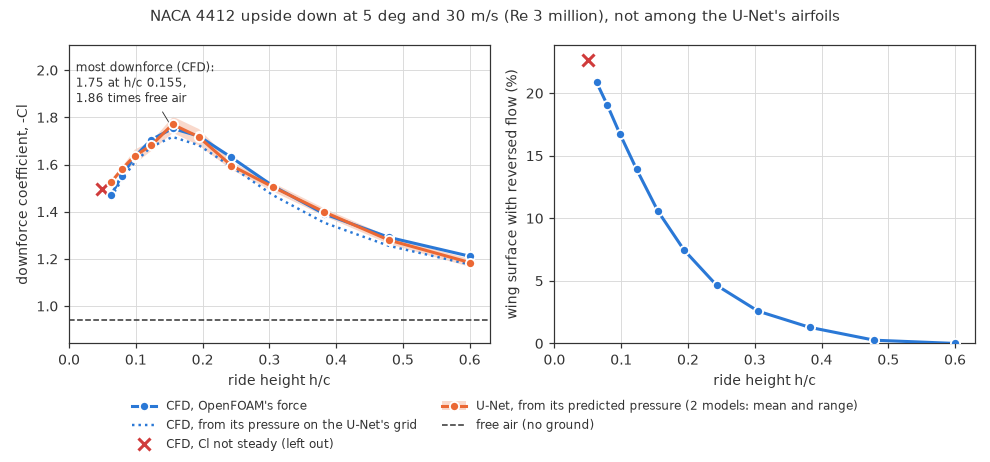

# 11. A wing the U-Net has not seen: the NACA 4412 near the ground

[README](../README.md) · ← [10. All the data](10-all-data.md) · [12. The F1 wing](12-tyrrell026-sweep.md) → · [Workflow](../README.md#workflow)

We simulated the NACA 4412 upside down at 12 ride heights and in free air,
then asked the U-Net for the same cases. The CFD shows the classic
ground-effect curve. The downforce grows as the wing comes closer and peaks
at h/c 0.155, with 1.86 times its free-air value. Closer still, it falls as
the flow separates. The U-Net has never seen this airfoil, yet it predicts
the downforce within 5% at every height and puts the peak at the same
height.

*Words used here: [glossary](glossary.md). References: [list](references.md).*

---

**The sweep.** The NACA 4412 is the airfoil of the LES comparison
([step 3](03-mesh-study.md)). It is neither among the 1,462 training airfoils
nor among the 30 test airfoils. Among the training airfoils, the NACA 4415 has
the same camber line, but it is 15% thick instead of 12% (4 of the 3,436
samples). The training airfoil closest in shape is goe623: its camber and
thickness differ from the NACA 4412's by at most 0.4% of the chord, about the
usual distance between neighbouring training airfoils (0.7% in the median).

We ran it upside down at 5° and 30 m/s (Reynolds number 3 million), in free
air and at 12 ride heights from h/c 0.05 to 0.6, evenly spaced on a log scale
(`sweep_naca4412.sh`, about 20 minutes with 4 runs at a time). The runs used
the settings and the convergence test of the [dataset](07-dataset.md): 1000
iterations, continued by 500 at a time up to 3000 while Cl settles. Cl
became steady at 11 of the heights (two of them needed 1500 iterations). At
h/c 0.05 it still varied by 8% at the end and was not settling, so that run
is left out, as it would be from the dataset.

## CFD

- **The ground adds downforce from far away.** Already at h/c 0.6 the wing
  makes 29% more downforce than in free air (−Cl 1.21 against 0.94). The
  downforce grows as the wing comes closer, up to 1.75 at h/c 0.155: 1.86
  times the free-air value.
- **Below the peak the flow separates.** Closer than h/c 0.155 the downforce
  falls: by 16% at h/c 0.063. There, 21% of the wing's surface has reversed
  flow (from none at h/c 0.6, 1.3% at 0.38 and 11% at the peak), and the drag
  is five times that at h/c 0.6 (Cd 0.077 against 0.015).
- The Tyrrell 026 wing in the wind tunnel ([step 4](04-wind-tunnel.md))
  showed the same rise, peak and fall.

## U-Net

We used the two U-Nets of [step 10](10-all-data.md) trained on all 3,096
samples, starting from the free-air model and with the wall weighting (seeds
0 and 1). For each of the 11 heights with a steady Cl, they get the same
inputs as in training (the oncoming air, and where the wing and the ground
are) and predict the pressure and the velocity.

Cl comes from the predicted pressure, as in [step 9](09-downforce.md). We
compare it with Cl from the simulated pressure, computed in the same way. On
this wing that is 1–3% below OpenFOAM's Cl (the dotted line in the figure).
The free-air run is left out: every training sample has a ground.

| h/c | CFD −Cl, OpenFOAM | CFD −Cl, same way as the U-Net | U-Net −Cl, mean of the 2 models | U-Net against CFD | Field error of the U-Net |
|---|---|---|---|---|---|
| 0.063 | 1.470 | 1.460 | 1.525 | +4.5% | 1.82% |
| 0.079 | 1.553 | 1.536 | 1.580 | +2.9% | 1.49% |
| 0.098 | 1.632 | 1.609 | 1.636 | +1.7% | 1.23% |
| 0.123 | 1.705 | 1.675 | 1.681 | +0.3% | 0.96% |
| 0.155 | 1.753 | 1.717 | 1.771 | +3.1% | 1.01% |
| 0.194 | 1.721 | 1.682 | 1.717 | +2.1% | 0.93% |
| 0.243 | 1.631 | 1.591 | 1.596 | +0.3% | 0.62% |
| 0.305 | 1.510 | 1.471 | 1.505 | +2.3% | 0.88% |
| 0.382 | 1.391 | 1.354 | 1.399 | +3.4% | 0.94% |
| 0.479 | 1.291 | 1.255 | 1.280 | +1.9% | 0.61% |
| 0.600 | 1.211 | 1.177 | 1.185 | +0.7% | 0.58% |

The field error has the output set to 0 in the solid, as in step 10. The
table is also in `results/sweep_naca4412.csv`, with the range of the two
models.

- **The U-Net reproduces the ground-effect curve.** Both models put the peak
  at h/c 0.155, as the CFD does. From h/c 0.6 to the peak their downforce
  grows by 49% (CFD: 46%), and from the peak to h/c 0.063 it falls by 14%
  (CFD: 15%).
- **The downforce is within 5% at every height.** The two models are off by
  1.3% and 3.4% on average. The largest difference is closest to the ground:
  +4.5% at h/c 0.063, where a fifth of the wing has reversed flow. Both predict slightly more
  downforce than the CFD on this wing. On the 102 test samples they have
  almost no such bias ([step 10](10-all-data.md)).
- **The predicted flow fields are close too.** The field error is 0.6–1.8%,
  largest closest to the ground, and 0.9% and 1.1% on average for the two
  models. That is below the 1.4% on the test samples: the NACA 4412 is an
  ordinary airfoil shape.
- **The loss matters here too.** The two U-Nets trained with the plain loss
  ([step 10](10-all-data.md)) also put the peak at h/c 0.155. But they predict
  less downforce than the CFD at 10 of the 11 heights: 3.5% less on average
  and up to 6% (at h/c 0.123). That is the bias of the plain loss. The two
  models trained from random weights with the wall weighting are as close as
  those from the free-air model (1.9% and 1.1% off on average).

**Next:** the Tyrrell 026 wing at the wind tunnel's ride heights (CFD, the
U-Net and the tunnel); figures of predicted and simulated flow fields.

---

[README](../README.md) · ← [10. All the data](10-all-data.md) · [12. The F1 wing](12-tyrrell026-sweep.md) → · [Workflow](../README.md#workflow)
