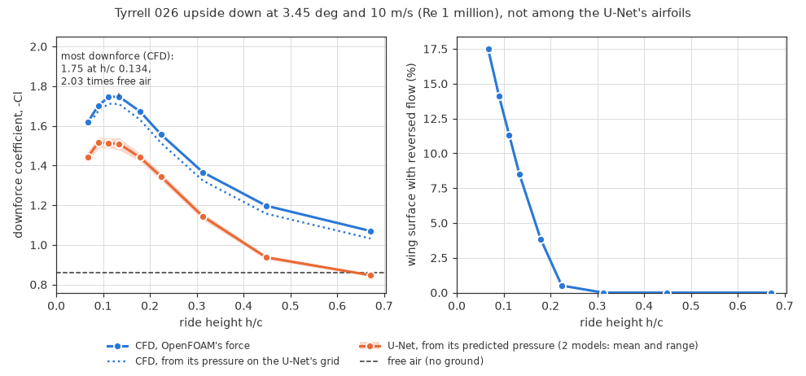

# 12. The F1 wing: the Tyrrell 026 at the tunnel's ride heights

[README](../README.md) · ← [11. A new wing](11-naca4412-sweep.md) · [13. The exact wing shape](13-distance-input.md) → · [Workflow](../README.md#workflow)

We ran the Tyrrell 026 wing of the wind-tunnel validation
([step 4](04-wind-tunnel.md)) at the conditions of the dataset, then asked the
U-Net for the same cases. The CFD keeps the curve it had at the tunnel's
Reynolds number, with 2–7% more downforce at the higher speed. The U-Net has
never seen this wing. It predicts the shape of the curve, but 10–19% too
little downforce, because it misses part of the suction peak near the leading
edge. Among unseen wings, the Tyrrell 026 is one of the hardest for the U-Net.

*Words used here: [glossary](glossary.md). References: [list](references.md).*

---

**The sweep.** The U-Net is trained at 10–50 m/s (Reynolds number 1–5
million with our 1 m chord), but the tunnel ran at 0.46 million. So this
sweep runs at 10 m/s (Re 1 million), the closest speed the U-Net covers. As
in step 4, the incidence is 3.45° and the ride height is set with the wing
at 2.45°. The runs cover the tunnel's 9 ride heights from h/c 0.067 to 0.671,
plus free air, with the settings of the [dataset](07-dataset.md)
(`sweep_tyrrell026.sh`, about 30 minutes). All 10 runs converged in 1000
iterations. The highest height, h/c 0.671, is above the 0.6 of the training
data.

## CFD

- **The same curve as at the tunnel's Reynolds number.** The downforce peaks
  at h/c 0.112–0.134 with 1.75, 2.03 times its free-air value, and falls by
  7% down to h/c 0.067. In step 4, the CFD, the CFL3D simulations and the
  tunnel also peaked there.
- **The higher speed gives more downforce.** Compared with the runs of step 4
  on the same mesh, there is 2% more in free air and 6–7% more around the
  peak. Closer to the ground the flow separates less: at h/c 0.134, 8.5% of
  the wing's surface has reversed flow, against 10.3%.

| h/c | −Cl at Re 0.46 million (step 4) | −Cl at Re 1 million | Change |
|---|---|---|---|
| 0.067 | 1.529 | 1.618 | +5.8% |
| 0.090 | 1.593 | 1.703 | +6.9% |
| 0.112 | 1.630 | 1.745 | +7.0% |
| 0.134 | 1.642 | 1.748 | +6.4% |
| 0.179 | 1.586 | 1.673 | +5.5% |
| 0.224 | 1.487 | 1.556 | +4.6% |
| 0.313 | 1.321 | 1.366 | +3.5% |
| 0.448 | 1.165 | 1.198 | +2.8% |
| 0.671 | 1.045 | 1.070 | +2.4% |
| free air | 0.843 | 0.859 | +2.0% |

## U-Net

The same two U-Nets as in [step 11](11-naca4412-sweep.md): all 3,096
samples, starting from the free-air model, with the wall weighting. Cl comes
from the predicted pressure and is compared with Cl from the simulated
pressure, computed in the same way (the dotted line).

| h/c | CFD −Cl, OpenFOAM | CFD −Cl, same way as the U-Net | U-Net −Cl, mean of the 2 models | U-Net against CFD | Field error of the U-Net |
|---|---|---|---|---|---|
| 0.067 | 1.618 | 1.600 | 1.442 | −9.9% | 1.71% |
| 0.090 | 1.703 | 1.676 | 1.516 | −9.5% | 1.69% |
| 0.112 | 1.745 | 1.712 | 1.513 | −11.6% | 1.98% |
| 0.134 | 1.748 | 1.710 | 1.510 | −11.7% | 1.81% |
| 0.179 | 1.673 | 1.631 | 1.441 | −11.7% | 1.89% |
| 0.224 | 1.556 | 1.513 | 1.344 | −11.2% | 1.81% |
| 0.313 | 1.366 | 1.324 | 1.144 | −13.6% | 2.21% |
| 0.448 | 1.198 | 1.158 | 0.938 | −19.0% | 3.07% |
| 0.671 | 1.070 | 1.032 | 0.847 | −17.9% | 3.32% |

- **The shape is right, the level is not.** The U-Net's curve has a flat top
  at h/c 0.090–0.134 (the CFD's at 0.112–0.134) and falls below it. But the
  downforce is 10–19% too small at every height: 14.2% and 11.6% on average
  for the two models.
- **The error is in the suction peak.** Most of the missing downforce is on
  the side facing the ground. At h/c 0.134 that side gives −Cl 1.59 in the
  CFD and 1.40–1.46 with the two U-Nets, while the top side gives 0.12 and
  0.08. Along the chord, the U-Net's suction on the side facing the ground is
  12–25% too weak at x/c 0.1–0.2, then close to the CFD from x/c 0.3 on. The
  Tyrrell's suction is concentrated further forward than the NACA 4412's,
  whose peak at x/c 0.2 the U-Net gets right.
- **Not the low speed.** 10 m/s is the slowest training speed. But on the 20
  validation samples at 10–12.5 m/s, the U-Net's downforce error is 6.0%, the
  same as at the other speeds (5.5–6.3%).
- **Not an unusual thickness or camber.** The Tyrrell 026 is 12.6% thick with
  2.9% camber, the 60th and 45th percentiles of the training airfoils.
- **Among the hardest unseen wings.** On the test airfoils, the median
  airfoil's downforce error is 5.5%. Three of the 28 test airfoils with
  samples are above 10%: mh49 (12%), bw3 (11%) and the strut e864, whose Cl is
  close to 0. The Tyrrell 026 (11.6% and 14.2% for the two models) is as hard
  as these, and the NACA 4412 (1.3% and 3.4%) is among the easiest.
- **The other models.** The two models trained from random weights with the
  wall weighting are closer on this wing (6.3% and 6.4%). The two trained
  with the plain loss are in between (9.5% and 8.8%). On the test samples the
  models from the free-air model were the best ([step 10](10-all-data.md)).
  With one wing, we cannot tell whether this difference is chance.

**Next:** four more batches of 1000 runs (about 6,200 training samples in
all), then the learning curve, the NACA 4412 and the Tyrrell 026 again;
figures of predicted and simulated flow fields.

---

[README](../README.md) · ← [11. A new wing](11-naca4412-sweep.md) · [13. The exact wing shape](13-distance-input.md) → · [Workflow](../README.md#workflow)
