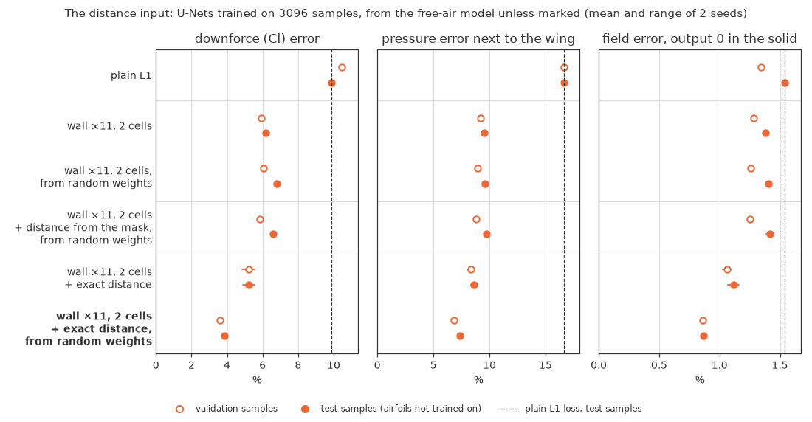
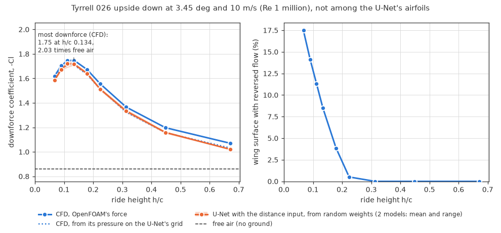
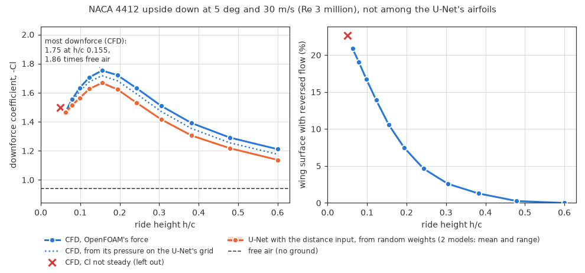

# 13. The exact wing shape: the distance to the surface as an input

[README](../README.md) · ← [12. The F1 wing](12-tyrrell026-sweep.md) · [Workflow](../README.md#workflow)

Until now the U-Net saw the wing only as a mask: each cell of its 128 × 128
grid is either wing or air, and a cell is 1/64 of the chord. We gave it the
exact shape as well, as one more picture: the distance from each point to the
nearest surface. Trained from random weights on the same 3,096 samples, its
downforce error on the 30 test airfoils falls from 6.8% to 3.9%, and its
field error from 1.41% to 0.87%. On the Tyrrell 026, the downforce is now
within 1.1% of the CFD at every ride height (step 12: 10–19% too low), but
the suction peak is still too weak. The same kind of distance computed from
the mask does not help (6.6%), so the gain comes from the shape finer than
the grid, and it shows in the whole flow, not only next to the wing.
Starting from the free-air model gains less (6.2% → 5.2%), so the final
model will start from random weights.

*Words used here: [glossary](glossary.md). References: [list](references.md).*

---

**Why.** In [step 12](12-tyrrell026-sweep.md) the U-Net missed part of the
Tyrrell 026's suction peak, close to the leading edge. That is where the
shape of the wing changes fastest, and the mask shows it only in steps of
1/64 of the chord: a wing 12% thick is about 8 cells thick. Earlier networks
for flow fields described the shape by the signed distance to it (Guo et al.
2016, Bhatnagar et al. 2019, Ribeiro et al. 2020).

**The input.** The U-Net has three inputs. The second was the sideways
component of the oncoming air, which set the angle of attack in the free-air
study. We turn the wing instead, so in our samples this input was always 0.
It now holds the signed distance:
- at each point of the grid, the distance to the nearest surface (the wing
  or the ground), in chords;
- positive in the air, negative inside the wing and below the ground.

The outline comes from the airfoil file of the sample, placed as in its
simulation (same angle and ride height), with a point every 0.0005 chords.
The mask stays the third input. The distance takes 34 ms per sample to build
(`train_unet.py --distance`, `unet_data.py`).

**Checks.**
- The rebuilt outline puts the ground exactly where the simulation had it,
  and the simulation's wall points lie within 0.0009 chords of it.
- The sign of the distance agrees with the mask in every sample of the
  dataset and the two sweeps, except on the outline itself and at two quirks
  of the data, points that OpenFOAM did not sample: one point just behind the
  trailing edge in 23 samples, and a row of 31 points behind the trailing
  edge in one sample (`e591`).
- The free-air model never saw this input, so its weights for it are set to
  0 before training. As it is, it then predicts exactly as before: field
  error 20.4%, downforce error 121%, as in [step 10](10-all-data.md).

**The test.** As in step 10: all 3,096 training samples, the wall weighting,
80,000 iterations, 2 seeds, from random weights and from the free-air model.
Only the input differs. The 4 runs took under an hour on Kaggle's two T4
GPUs (see [How to run it](howto.md)).

## Test samples

Test samples, mean of the 2 seeds, all with the wall weighting
(`loss_study.py`):

| Inputs | Start | Field error, output 0 in the solid | Pressure next to the wing | Downforce (Cl) | R² of Cl |
|---|---|---|---|---|---|
| mask (step 10) | free-air model | 1.38% | 9.5% | 6.2% | 0.94 |
| mask (step 10) | random weights | 1.41% | 9.6% | 6.8% | 0.90 |
| mask + distance from the mask | random weights | 1.42% | 9.7% | 6.6% | 0.90 |
| mask + exact distance | free-air model | 1.12% | 8.6% | 5.2% | 0.95 |
| mask + exact distance | random weights | 0.87% | 7.3% | 3.9% | 0.95 |

With the plain loss (step 10): 1.54%, 16.6%, 9.9% and 0.84. The distance
from the mask is explained [below](#shape-or-form); elsewhere on this page,
"the distance" is the exact one.

- **From random weights, the errors fall by a quarter to a half.** The
  downforce error drops from 6.8% to 3.9% (for the median sample, from 4.6%
  to 2.3%), the field error from 1.41% to 0.87% and the pressure error next
  to the wing from 9.6% to 7.3%. With the distance, Cl comes closer to the
  simulation on 81 of the 102 test samples (mean of the 2 seeds; Wilcoxon
  test, p = 3.5 × 10⁻¹²) and on 259 of the 340 validation samples. On the
  validation samples, it improves in every range of ride height, angle and
  speed, by 16–57%. The two seeds agree: 3.83% and 3.88%.
- **About what four doublings of the data would give.** In step 10, each
  doubling of the data lowered the downforce error by about 13%. If that
  held, a drop of 43% would take 16 times the data.
- **From the free-air model, the gain is smaller.** Its downforce error
  falls from 6.2% to 5.2% (closer on 67 of the 102 test samples, p = 0.002)
  and its field error from 1.38% to 1.12%. So with the distance, the
  free-air model is the worse start: from random weights, Cl is closer on 76
  of the 102 test samples (p = 1.2 × 10⁻⁶). Perhaps its layers, trained
  without the distance, do not learn to use it in 80,000 iterations.
- **Still the hardest samples.** The largest errors are still on the strut
  e864, whose Cl is close to 0, and on bw3 at h/c 0.073, which got worse
  (Cl off by 0.48, against 0.26).

## Shape or form?

The exact distance differs from the mask in two ways. It is another kind of
picture: smooth, where the mask is only 0 or 1. And it holds the shape
between the grid points, which the mask cannot show. To tell the two apart,
we trained the U-Net once more with a distance computed from the mask itself
(`train_unet.py --distance mask`): the same kind of picture, but with no more
of the shape than the mask shows. It puts the surface halfway between each
solid point and the air points next to it. On the test samples it differs
from the exact distance by 0.36 cells on average, and its sign agrees with
the mask everywhere. Same samples, settings and seeds, from random weights;
the 2 runs took 22 minutes on Kaggle. All the comparisons below are between
models trained from random weights.

- **The shape, not the form.** With the distance from the mask, the
  downforce error is 6.6% (seeds: 6.66% and 6.51%), against 6.8% with the
  mask alone, and the field error is the same (1.42% and 1.41%). Cl comes
  closer to the simulation on 52 of the 102 test samples (p = 0.69) and on
  177 of the 340 validation samples (p = 0.22): no difference we can
  measure. The exact distance is closer than the distance from the mask on
  80 of the 102 test samples (p = 5.4 × 10⁻⁹) and on 249 of the 340
  validation samples (p = 8.9 × 10⁻²⁴). So what helps is the shape finer
  than the grid.
- **Except very close to the ground.** Below h/c 0.08 (79 test and
  validation samples), the distance from the mask does help: the downforce
  error falls from 6.6% to 5.7% (closer on 50 of the 79, p = 0.003), and
  the exact distance adds less there (4.8%) than at any other ride height.
  The gap under the wing is only 3–5 cells high there. Perhaps the distance
  helps because it gives the height of the gap in every cell of it, while
  from the mask the U-Net has to find it from the solid cells above and
  below.
- **Not mainly the trailing edge.** The grid points rarely fall inside the
  thin trailing edge, so in the mask the wing ends early: 2 cells (0.03
  chords) before its true end on average, and up to 11 cells (0.17 chords)
  for the thin mh49. For the mh49, only the exact distance helps: on its 6
  test samples, Cl is off by 0.17 on average with the distance from the
  mask (0.15 with the mask alone), and by 0.03 with the exact one. But over
  all 442 test and validation samples, the gain from the exact distance
  does not grow with how much of the trailing edge the mask misses
  (Spearman ρ = 0.04), nor with how much the grid rounds the ride height
  (ρ = 0.01).
- **Better in the whole flow.** Of the drop in the pressure error from the
  distance from the mask to the exact distance (test samples, cells in the
  air), 80% lies more than 0.1 chords from the wing (92% of the cells),
  where the error falls by 44–47%, against 28–35% closer to the wing. The
  cells within 0.1 chords of the leading and the trailing edge give 2% and
  1% of it. A lifting wing sets the pressure far around it through its
  circulation, so this suggests that the exact shape mainly helps the U-Net
  to get the circulation right: perhaps through the camber and the angle of
  the surface, which the mask shows only to the nearest cell.
- **The two wings agree.** In the sweeps of steps 11 and 12, the models
  with the distance from the mask are about as far off as those with the
  mask alone. On the Tyrrell 026 they give 8.5% too little downforce on
  average (mask alone: 6.3%, exact distance: 0.5% off). On the NACA 4412
  they are 1.2% off on average (mask alone: 1.3%, exact distance: 2.8%).
  Tables: [Tyrrell 026](../results/sweep_tyrrell026_distance_mask.csv),
  [NACA 4412](../results/sweep_naca4412_distance_mask.csv).

## The two wings again

The sweeps of steps 11 and 12, with the two models trained from random
weights with the distance input. As before, their Cl comes from the
predicted pressure and is compared with Cl from the simulated pressure,
computed in the same way (the dotted line).

The U-Net against the CFD (mean of the 2 models of each kind):

| h/c | CFD −Cl, same way as the U-Net | Mask, free-air model (step 12) | Mask, random weights | Mask + distance, free-air model | Mask + distance, random weights | Field error, mask + distance, random weights |
|---|---|---|---|---|---|---|
| 0.067 | 1.600 | −9.9% | −3.9% | −5.6% | −1.1% | 1.17% |
| 0.090 | 1.676 | −9.5% | −5.2% | −4.5% | −0.2% | 0.84% |
| 0.112 | 1.712 | −11.6% | −6.8% | −6.1% | +0.5% | 1.09% |
| 0.134 | 1.710 | −11.7% | −5.3% | −6.0% | +0.4% | 0.87% |
| 0.179 | 1.631 | −11.7% | −6.7% | −7.2% | +0.6% | 0.71% |
| 0.224 | 1.513 | −11.2% | −5.8% | −7.0% | −0.1% | 0.64% |
| 0.313 | 1.324 | −13.6% | −2.9% | −8.7% | +0.7% | 0.63% |
| 0.448 | 1.158 | −19.0% | −9.5% | −11.1% | +0.1% | 0.55% |
| 0.671 | 1.032 | −17.9% | −10.8% | −10.1% | −1.1% | 0.87% |

- **The Tyrrell 026: within 1.1% at every height.** The error is 0.5% on
  average (step 12: 12.9%), the field error 0.55–1.17% (step 12:
  1.69–3.32%), and the curve has the CFD's flat top at h/c 0.112–0.134
  (step 12: 0.090–0.134). Random weights
  alone halve the error (6.3% on average), the distance alone from the
  free-air model does about as much (7.4%), and only the two together get it
  right.
- **The suction peak is still too weak.** On the side facing the ground, at
  x/c 0.1–0.3, the suction is 7–14% too weak at h/c 0.067, 0.134 and 0.448
  (step 12: 13–23%). At x/c 0–0.1 it is 13–24% too strong, and further back
  slightly too strong. At h/c 0.134, that side gives −Cl 1.587 in the CFD
  and 1.587 with the U-Net (step 12: 1.43). So part of the agreement in the
  downforce comes from errors that cancel.

| h/c | CFD −Cl, same way as the U-Net | Mask, free-air model (step 11) | Mask, random weights | Mask + distance, free-air model | Mask + distance, random weights | Field error, mask + distance, random weights |
|---|---|---|---|---|---|---|
| 0.063 | 1.460 | +4.5% | +4.2% | +0.3% | +0.2% | 1.26% |
| 0.079 | 1.536 | +2.9% | +1.5% | +0.1% | −1.5% | 1.03% |
| 0.098 | 1.609 | +1.7% | +0.4% | −0.8% | −2.9% | 0.75% |
| 0.123 | 1.675 | +0.3% | +0.1% | −2.5% | −2.9% | 0.72% |
| 0.155 | 1.717 | +3.1% | +1.8% | −0.7% | −2.9% | 0.69% |
| 0.194 | 1.682 | +2.1% | +0.6% | +0.3% | −3.5% | 0.82% |
| 0.243 | 1.591 | +0.3% | −0.8% | −1.1% | −3.8% | 0.84% |
| 0.305 | 1.471 | +2.3% | +1.8% | +0.1% | −3.7% | 0.79% |
| 0.382 | 1.354 | +3.4% | +1.7% | +0.3% | −3.6% | 0.84% |
| 0.479 | 1.255 | +1.9% | +0.6% | −1.7% | −3.0% | 0.77% |
| 0.600 | 1.177 | +0.7% | −0.3% | −1.7% | −3.3% | 0.70% |

- **The NACA 4412: within 4%, now a little low.** The models are 3.8% below
  to 0.2% above the CFD (−2.8% on average); in step 11 they were 0.3–4.5%
  above it. The peak is at h/c 0.155, as in the CFD. Here the models from
  the free-air model with the distance are closer (−0.7% on average). With
  two wings we cannot say which start is better on unseen wings; the 102
  test samples say random weights.

**Next:** four more batches of 1000 runs (about 6,200 training samples),
then the final model, with the distance input and from random weights; the
learning curve and both sweeps again; figures of predicted and simulated
flow fields.

---

[README](../README.md) · ← [12. The F1 wing](12-tyrrell026-sweep.md) · [Workflow](../README.md#workflow)
