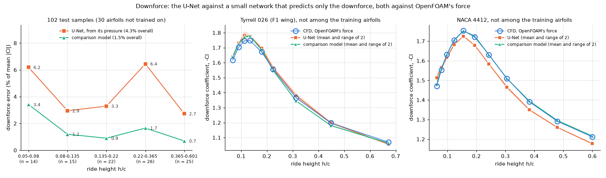

# 14. The downforce alone: a model that skips the flow

[README](../README.md) · ← [13. The exact wing shape](13-distance-input.md) · [Workflow](../README.md#workflow)

The U-Net gets the downforce by adding up its predicted pressure around the
wing. Would a simpler model that predicts only the downforce do better? It
does. A small network that takes the airfoil's shape, the ride height, the
angle and the speed, trained on the same 3,096 samples, predicts the
downforce of the 30 test airfoils with a 1.6% error, against the U-Net's 3.9%.
Compared with OpenFOAM's own force, it is 1.5% against 4.3%, and it is closer
on 92 of the 102 test samples. It is better at every ride height and angle.
On the two wings that neither model saw, both are 1.2% off on average on the
Tyrrell 026; on the NACA 4412 the small network is 0.2% off and the U-Net
2.2%. So for the downforce alone, predicting the whole flow costs accuracy.
What the U-Net adds is the flow itself.

*Words used here: [glossary](glossary.md). References: [list](references.md).*

---

**Why.** Any reviewer will ask whether the U-Net is the best way to get the
downforce. A fair answer needs the same samples, the same measure, and a
comparison model tuned with care.

**The model** (`baseline_cl.py`). A small fully connected network (MLP). It
gets 68 numbers for each sample:
- the shape, from the airfoil file the simulation used: the camber line and
  the thickness at 32 points along the chord, closer together at the leading
  and the trailing edge;
- the ride height h/c and its logarithm, the angle of attack and the speed.

It gives one number, Cl. It is trained on the U-Net's 3,096 training samples
and tested on the same 102 test samples. The same 340 validation samples
choose its weights during training (checked every 10 of the 1000 passes over
the data) and its settings below.

**Tuning.** We tried 54 combinations of width (128, 256 or 512 neurons per
layer), depth (2, 3 or 4 layers), weight decay (3 values) and learning rate
(2 values), each with 2 seeds: 108 models, about a minute each on Kaggle's
GPUs. Only the validation samples chose. The best is 4 layers of 128 neurons
(58,497 weights; the U-Net has 2.3 million). The three best combinations all
have this size, so the choice is not a fluke of one setting, and the higher
learning rate was always worse. The U-Net itself was not tuned: it is
Thuerey et al.'s network.

**Two ways to compare.** Until now we compared the U-Net's Cl with Cl from the
simulated pressure on the same 128 × 128 grid. That Cl is 3.3% below
OpenFOAM's, which comes from the pressure and friction on the true surface.
Even after a straight-line correction (OpenFOAM's Cl = 1.035 × the grid's) it
scatters by 1.4% around OpenFOAM's, depending on how the wing falls on the
grid. The U-Net can see the grid, the small network cannot. So we compare
both ways:
- with the grid's Cl, as in steps 9–13;
- with OpenFOAM's force: the small network learns OpenFOAM's Cl (a second
  tuning, same combinations), and the U-Net's Cl is corrected by the
  straight line, fitted on the training samples.

## Test samples

Test samples, mean of the 2 seeds of each model:

| Compared with | Model | Downforce error | Median sample | R² of Cl | Closer than the U-Net |
|---|---|---|---|---|---|
| the grid's Cl | U-Net (step 13) | 3.86% | 2.3% | 0.95 | |
| the grid's Cl | small network | 1.61% | 0.9% | 0.99 | 81 of 102 (p = 2 × 10⁻¹²) |
| OpenFOAM's force | U-Net, corrected | 4.32% | 2.6% | 0.95 | |
| OpenFOAM's force | small network | 1.46% | 0.8% | 0.99 | 92 of 102 (p = 7 × 10⁻¹⁵) |

The p values are those of a Wilcoxon test on each sample's error (mean of
the 2 seeds).

- **Two to three times more accurate.** On the validation samples it is the
  same: 1.81% against 3.59% with the grid's Cl, and 1.55% against 3.91% with
  OpenFOAM's force (closer on 292 of 340). The seeds agree (test, OpenFOAM's
  force: 1.43% and 1.49%).
- **At every ride height and angle.** By ride height, against OpenFOAM's
  force, the small network's error is 0.7–1.7%, and 3.4% below h/c 0.08; the
  U-Net's is 2.7–6.4%, and 6.2% below h/c 0.08. Both are worst there, close
  to the ground, where the flow separates. By angle, it is 0.9–1.9% against
  2.8–7.1%.
- **Much smaller and faster.** One prediction takes 0.13 ms on one CPU
  thread, against 46 ms for the U-Net and a median of 318 s for one
  simulation on one core.

## The two wings

The sweeps of steps 11 and 12. Against OpenFOAM's force, with the U-Net of
step 13 (random weights, distance input; mean of 2 models of each kind):

| Wing | U-Net, corrected | Small network |
|---|---|---|
| Tyrrell 026, 9 ride heights | +0.9% on average (1.2% off; −1.3% to +2.0%) | +0.3% on average (1.2% off; −1.6% to +1.8%) |
| NACA 4412, 11 ride heights | −1.5% on average (2.2% off; −2.9% to +3.0%) | +0.2% on average (0.2% off; −0.1% to +0.8%) |

- **The F1 wing: a tie.** Both are within 2% at every ride height. The small
  network puts the most downforce at h/c 0.134, as OpenFOAM does; the U-Net
  at 0.112, where the grid's Cl peaks. The top of the curve is flat there
  (OpenFOAM: 1.745 at 0.112, 1.748 at 0.134).
- **The NACA 4412: almost exact.** The small network follows the CFD within
  0.8% at every height and puts the peak at h/c 0.155, as the CFD does.
- **Against the grid's Cl**, as in steps 11–13, the U-Net is 0.5% off on
  the Tyrrell 026 and the small network 0.9%; on the NACA 4412 they are 2.8%
  and 0.8% off.

## What it means

- **For the downforce alone, use the small network.** The U-Net's downforce
  comes from its pressure in the cells next to the wing, which is 7.3% off
  there (step 13). The small network learns the number directly. In step 9,
  a downforce term in the U-Net's loss fixed the sum but not the pressure.
- **The U-Net gives what one number cannot:** the pressure and the velocity
  everywhere around the wing, where the suction is, where the flow
  separates, the wake. Its field error is 0.9%, and even its downforce is
  within about 1–2% on the F1 wing.
- **The U-Net takes the shape as a picture.** The small network needs the
  wing described as one camber line and one thickness: a wing with several
  elements, a flap or a shaped ground would need a new description, and new
  data. The U-Net's input can show any of them.
- **So the two work together:** the U-Net for the flow, the small network
  for the downforce.

**Next:** both models again with all the data after the four batches, and
the prediction script giving the downforce of the small network next to the
U-Net's flow.

---

[README](../README.md) · ← [13. The exact wing shape](13-distance-input.md) · [Workflow](../README.md#workflow)
