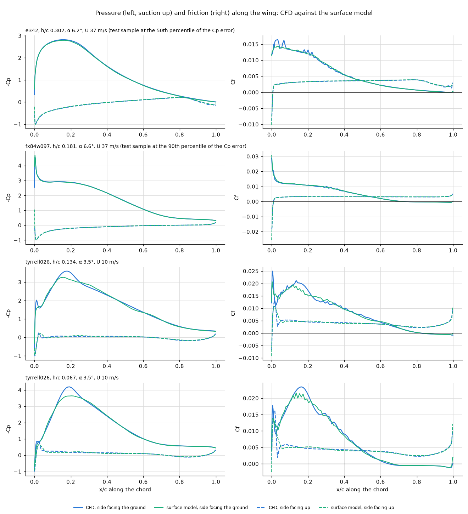

# 15. The pressure along the wing: a model of the surface

[README](../README.md) · ← [14. The downforce alone](14-downforce-model.md) · [Workflow](../README.md#workflow)

Between the small network of step 14, which gives one number, and the U-Net,
which gives the whole flow, there is a middle way: the pressure and the
friction along the wing's surface. That is what pushes on the wing, and what
wind tunnels measure with pressure holes in the model. A small network that
predicts these two curves, from the same inputs as step 14, gets the
downforce of the 30 test airfoils within 1.3% of OpenFOAM's force: as close
as the step 14 network, and three times closer than the U-Net. It also gives
the drag (8.7% off on the test airfoils, 2–3% on the two wings), the moment
(2.5%) and where the flow separates (the separated part of the surface, 10%
of it on average, is off by 0.3% of the surface on average). On the F1 wing
its suction peak is too low, as the U-Net's was, so the downforce comes out
2% low.

*Words used here: [glossary](glossary.md). References: [list](references.md).*

---

**The data** (`surface_data.py`). Every sample stores OpenFOAM's pressure and
wall friction at the middle of each face of the mesh on the wing (404–450
faces), in the mesh's own order. To use them we rebuilt the surface exactly as
the simulation saw it, because three small differences each cost several
percent of the drag:
- **the curve:** gmsh draws a smooth curve through the airfoil's points (a
  Catmull-Rom spline), not straight lines between them. Around the nose the
  straight lines point slightly the wrong way;
- **the faces:** gmsh cuts that curve into equal faces of at most 0.005
  chords, rounding the number up. Rounding down shifts every face a little,
  half a face by the nose;
- **the positions:** each value gets the exact middle of its face. Around
  the nose the pressure changes by several units from one face to the next,
  so a shift of 0.0001 chords there already changes the drag by about a
  percent.

The pressure drag is the small difference of two large forces at the nose
(the air pushing on it and the suction around it), which is why these
details matter for the drag and hardly at all for the downforce. With them,
on the 102 test samples, every value lies at the middle of a rebuilt face,
and adding the samples' own values face by face gives OpenFOAM's downforce
within 0.005% and its drag within 0.3% on average.

The model's outputs are the pressure (Cp) and the friction (Cf) at 128 points
on each side of the wing (the side facing the ground and the side facing up),
closer together at the leading and the trailing edge, and the mean pressure
on a blunt trailing edge: 513 numbers. Added up face by face in the same way,
these 128 points per side still give OpenFOAM's downforce within 0.015% and
its drag within 0.5%.

**The model** (`surface_model.py`). A fully connected network like that of
step 14, with the same 68 inputs (the shape, the ride height, the angle, the
speed), the same samples and the same split, and 513 outputs. Four layers of
256 neurons, not yet tuned; 25,000 steps, about 6 minutes on the CPU; the
weights with the lowest validation error are kept; 2 seeds.

## Test samples

Against OpenFOAM's force, mean of the 2 seeds:

| | Test samples | Validation samples |
|---|---|---|
| Downforce (Cl) | 1.34% | 1.69% |
| Drag (Cd) | 8.7% | 6.7% |
| Moment (Cm, about the quarter chord) | 2.5% | 2.7% |
| Pressure along the surface, mean \|ΔCp\| | 0.034 | 0.035 |
| Friction, mean \|ΔCf\| (Cf is about 0.005 on average) | 0.0003 | 0.0003 |
| Separated part of the surface, mean error (CFD: 10% of the surface on average) | 0.3% of the surface | 0.6% of the surface |

- **The downforce: as good as the model of step 14.** 1.34% against 1.46%
  on the test samples, and 1.69% against 1.55% on the validation samples:
  no difference that a Wilcoxon test can tell (p = 0.18 and 0.27). The U-Net
  is 4.3% off, and the surface model is closer on 91 of the 102 test samples
  (p = 2 × 10⁻¹⁶).
- **The curves follow the CFD.** For the test sample with the median error
  and for the one at the 90th percentile, the predicted pressure and friction
  lie on the simulated ones, the separated flow at the trailing edge (the
  friction below 0) included.
- **Drag is the hardest, also for the simulations.** On the dataset's mesh
  the simulated drag itself carries about 10% numerical uncertainty, against
  0.04% for the downforce ([step 3](03-mesh-study.md)), so the drag targets
  are less certain than the downforce targets. For the median test sample,
  the drag is 8.4% off.
  The error grows with the ride height, as the drag gets smaller: 3.7% below
  h/c 0.08, 17% above h/c 0.365. The largest errors are on the strut e864
  (Cl close to 0) and on bw3, which were also the U-Net's hardest samples.

## The two wings

Against OpenFOAM's force (mean of the 2 models; tables:
[NACA 4412](../results/sweep_naca4412_surface_model.csv),
[Tyrrell 026](../results/sweep_tyrrell026_surface_model.csv)):

| Wing | Downforce | Drag |
|---|---|---|
| NACA 4412, 11 ride heights | −0.1% on average (−0.3% to +0.2%) | +2.1% on average (−0.5% to +5.0%) |
| Tyrrell 026, 9 ride heights | −2.0% on average (−2.8% to −1.0%) | +2.8% on average (0.0% to +5.7%) |

- **The NACA 4412 is almost exact:** the downforce within 0.3% at every
  height, the drag within 5%.
- **The F1 wing's suction peak is too low.** The Tyrrell 026 has a sharp
  suction peak at about 20% of the chord, sharper than most airfoils in the
  data. The model rounds it off (at h/c 0.067: −Cp 3.6 instead of 4.2), as
  the U-Net did in step 13, so its downforce is 1–3% low at every height.
  Here the model of step 14 and the U-Net are closer (1.2% off on average).

## What it means

Three models, from one number to the whole flow:

| | Gives | Downforce, test samples | Also |
|---|---|---|---|
| Small network (step 14) | the downforce | 1.5% | |
| Surface model | the pressure and the friction along the surface | 1.3% | drag, moment, where the flow separates |
| U-Net (step 13) | the flow everywhere around the wing | 4.3% | the whole flow, any shape as a picture |

The surface model gives everything the downforce network gives, at the same
accuracy, and the quantities a designer looks at next: the drag, the moment
(where the force acts), the pressure curve and the separated flow. The U-Net
remains the model for the flow away from the wing, the wake and the gap
under it.

**Next:** with all the data after the four batches, the final versions of
the three models, with a tuning of the surface model like that of step 14.

---

[README](../README.md) · ← [14. The downforce alone](14-downforce-model.md) · [Workflow](../README.md#workflow)
