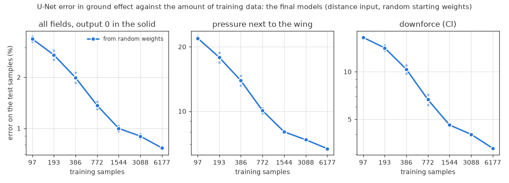
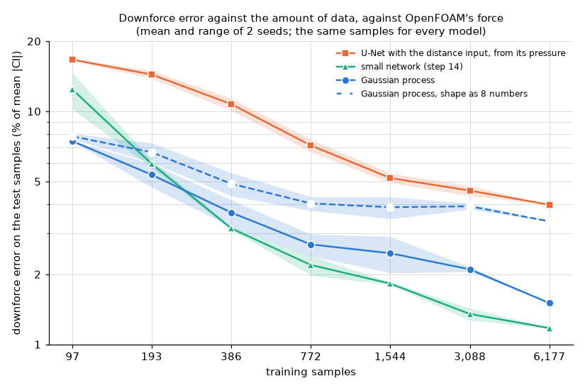

# 16. All the data: the final models

[README](../README.md) · ← [15. The pressure along the wing](15-surface-model.md) · [17. The drag alone](17-drag-model.md) → · [Workflow](../README.md#workflow)

With all eight batches of simulations done, the dataset has twice the
samples of steps 10–15: 6,886 from 8,000 runs, on 1,416 airfoils. We
trained the three models again on all of them in one Kaggle notebook
(8 h 15 min on two GPUs), chose the small models' settings again on the
validation samples, and extended the learning curves to all the data, with
a Gaussian process for the downforce. On the 28 test airfoils all three
models are 12–15% better than with half the data: the U-Net's field error is 0.76%
and its downforce error 3.3%, and the two small models are 1.2% off
OpenFOAM's downforce, about three times closer than the U-Net. With up to
about 200 training samples, the Gaussian process predicts the downforce
best. One prediction takes under a millisecond with the small network and
28 ms with the U-Net, against a median of 318 s for a simulation.

*Words used here: [glossary](glossary.md). References: [list](references.md).*

---

**The data.** Of the 8,000 runs, 152 (1.9%) stopped with an error, 130 of
them in the mesh generator, and left no sample. Of the other 7,848, 962
(12.3%) did not converge, mostly close to the ground at high angles (see
[step 6](06-parameter-scan.md)). The 6,886 samples split into 6,177 for
training and 709 for validation (the same 10%, chosen by the file name, as
before). The test samples are those of [step 7](07-dataset.md): 102 samples
of 28 airfoils.

**The runs** (one Kaggle notebook; the commands are in [How to run it](howto.md)):
- the U-Net of [step 13](13-distance-input.md) (the distance input, random
  starting weights, the loss weighted next to the wing), with all the
  training samples and with 1/2 to 1/64 of them, 2 seeds each; and once
  more with all of them and twice the training (160,000 iterations);
- the network of [step 14](14-downforce-model.md), its settings chosen again
  among the same 54 combinations, for the grid's Cl and for OpenFOAM's
  force. The best now has four layers of 256 neurons (128 before);
- the surface model of [step 15](15-surface-model.md), now tuned as well:
  the best of 8 combinations of width, depth and weight decay has four
  layers of 512 neurons (256 before);
- the learning curves of the downforce: the network of step 14 and a
  Gaussian process, on the same samples as the U-Net at each size.

Back on Windows, the small models loaded from the output give the same
results as on Kaggle, from the same training samples.

## Test samples

Mean of the 2 seeds. The U-Net's downforce is compared with the grid's Cl,
as in steps 9–13, and with OpenFOAM's force, as in step 14:

| | 3,096 training samples (steps 13–15) | 6,177 training samples |
|---|---|---|
| U-Net: field error, output 0 in the solid | 0.87% | 0.76% |
| U-Net: Thuerey et al.'s error (all fields) | 1.11% | 0.99% |
| U-Net: pressure / velocity | 6.9% / 0.91% | 6.8% / 0.79% |
| U-Net: pressure next to the wing | 7.3% | 6.7% |
| U-Net: downforce from its pressure, against the grid's Cl | 3.9% | 3.3% |
| U-Net: the same, against OpenFOAM's force | 4.3% | 4.0% |
| Network of step 14: downforce, against the grid's Cl / OpenFOAM's force | 1.6% / 1.5% | 1.5% / 1.2% |
| Surface model: downforce / drag / moment | 1.3% / 8.7% / 2.5% | 1.2% / 7.5% / 2.2% |
| Surface model: pressure along the surface, mean \|ΔCp\| | 0.034 | 0.031 |
| Gaussian process: downforce, against OpenFOAM's force | – | 1.5% |

- **All three models are better with twice the data,** by 12–15%: the U-Net's
  field error by 12% and its downforce error by 15%; against OpenFOAM's
  force, the network of step 14 by 15% and the surface model by 12% (its
  drag by 14%).
- **The small models stay about three times closer for the downforce:**
  1.2% against 4.0% for the U-Net. The network of step 14 is closer than
  the U-Net on 90 of the 102 test samples (Wilcoxon p = 3 × 10⁻¹⁴); it and
  the surface model are still equally good (p = 0.22).
- **Near copies:** without the 7 samples of the two test airfoils that are
  near copies of training airfoils ([step 7](07-dataset.md)), the errors
  are 3–5% higher, as before: the field error 0.79% instead of 0.76%, the
  U-Net's downforce 3.4% instead of 3.3%.

## More data

The U-Net on 1/64 to all of the training samples (test samples, mean of
the 2 seeds):

| Training samples | 97 | 193 | 386 | 772 | 1,544 | 3,088 | 6,177 |
|---|---|---|---|---|---|---|---|
| Field error, output 0 in the solid | 3.36% | 2.71% | 1.99% | 1.37% | 1.00% | 0.90% | 0.76% |
| Pressure next to the wing | 21.9% | 17.9% | 13.9% | 10.1% | 8.0% | 7.4% | 6.7% |
| Downforce, against the grid's Cl | 16.5% | 14.2% | 10.4% | 6.7% | 4.6% | 4.0% | 3.3% |

- **More data still helps, but each doubling gains less.** Up to about
  1,500 samples, each doubling lowers the field error by 20–30% and the
  downforce error by 15–35%; the last two doublings lower them by 10% and
  16%, and by 13% and 18%.
- **Longer training does not help.** With 160,000 iterations instead of
  80,000 (all the samples, 2 seeds), the field error falls a little (0.76%
  → 0.75%; the pressure next to the wing 6.7% → 6.4%), but the downforce
  error rises (3.3% → 3.5%).

The downforce of every model against OpenFOAM's force, on the same samples
at each size ([table](../results/downforce_learning_curve_final.csv)):

| Training samples | 97 | 193 | 386 | 772 | 1,544 | 3,088 | 6,177 |
|---|---|---|---|---|---|---|---|
| Gaussian process | 7.4% | 5.3% | 3.7% | 2.7% | 2.5% | 2.1% | 1.5% |
| Gaussian process, shape as 8 numbers | 7.8% | 6.7% | 4.9% | 4.0% | 3.9% | 3.9% | 3.4% |
| Network of step 14 | 12.4% | 6.0% | 3.1% | 2.2% | 1.8% | 1.4% | 1.2% |
| U-Net | 16.7% | 14.4% | 10.7% | 7.1% | 5.2% | 4.6% | 4.0% |

- **With few samples, the Gaussian process is best:** with 97 samples it is
  7.4% off, the network of step 14 12.4% and the U-Net 16.7%. From 386
  samples on, the network is better; with all the samples only by a small
  margin, which is not significant over the 28 test airfoils
  ([step 19](19-classical-baselines.md)). (Here the network keeps the settings
  of step 14's first tuning, four layers of 128 neurons, at every size; the
  one tuned on all the samples, in the table above, is 1.24% off.)
- **The Gaussian process knows how sure it is:** 83–95% of its errors lie
  within 1.96 of its standard deviations, against 95% if they were exact.
- **The shape as 8 numbers** (the first 8 principal components of the 64)
  is worse at every size, and more so with more samples: 3.4% against 1.5%
  with all of them.

## The two wings

The sweeps of steps 11 and 12, with the final models and with those of
steps 13–15. Against OpenFOAM's force, the mean (and the largest)
difference over the ride heights (tables:
[U-Net, NACA 4412](../results/sweep_naca4412_final.csv),
[U-Net, Tyrrell 026](../results/sweep_tyrrell026_final.csv),
[network of step 14](../results/downforce_model_final.csv),
[surface model, NACA 4412](../results/sweep_naca4412_surface_model_final.csv),
[surface model, Tyrrell 026](../results/sweep_tyrrell026_surface_model_final.csv),
[Gaussian process, NACA 4412](../results/sweep_naca4412_gp_final.csv),
[Gaussian process, Tyrrell 026](../results/sweep_tyrrell026_gp_final.csv)):

| | NACA 4412, 3,096 samples | NACA 4412, 6,177 | Tyrrell 026, 3,096 | Tyrrell 026, 6,177 |
|---|---|---|---|---|
| U-Net | 2.2% (3.0%) | 0.63% (1.9%) | 1.2% (2.0%) | 2.4% (3.0%) |
| Network of step 14 | 0.24% (0.75%) | 0.19% (0.39%) | 1.2% (1.8%) | 0.36% (0.72%) |
| Surface model | 0.15% (0.30%) | 0.27% (0.51%) | 2.0% (2.8%) | 0.38% (0.84%) |
| Surface model: drag | 2.3% | 4.0% | 2.8% | 4.7% |
| Gaussian process ([how](howto.md#the-gaussian-process-on-the-sweeps)) | – | 0.29% (1.0%) | – | 1.1% (1.7%) |

- **The small models are now close on both wings:** within 0.9% of
  OpenFOAM's force at every height. They gained the most on the F1 wing:
  0.4% off on average, against 1.2% and 2.0% with half the data.
- **The U-Net is better on the NACA 4412 and a little worse on the F1
  wing,** where it now gives 1.3–3.0% too much downforce. Against the
  grid's Cl, which is what it learns, it is within 2.0% on the NACA 4412
  and 2.6% on the F1 wing.
- **The peaks:** all three models put the NACA 4412's largest downforce at
  the CFD's ride height, h/c 0.155. The Tyrrell 026's peak is almost flat
  between h/c 0.112 and 0.134 (OpenFOAM: 1.745 and 1.748); all three put
  it at 0.134, as OpenFOAM does, the U-Net by only 0.03%.
- **The Gaussian process** (added later, fitted on all the samples) lies
  between the small networks and the U-Net: 0.29% and 1.1% off on average.
  Its standard deviation shows which wing is less like the data: 0.9–1.5%
  of the downforce on the NACA 4412, 2.3–6.1% on the F1 wing, the most at
  h/c 0.671, above the ride heights of the samples. OpenFOAM's force lies
  within 1.96 standard deviations at all 20 heights: the uncertainty is
  cautious, not too sure. It puts the F1 wing's peak at h/c 0.112, one step
  lower than OpenFOAM, by 0.07%.
- **The surface model's drag on the two wings got worse:** 4.0% and 4.7%
  off on average, too high on the NACA 4412 and too low on the F1 wing at
  every height, although its drag on the test samples improved
  (8.7% → 7.5%).

## How fast

All the models timed again by one method: the steps of `predict.py` on one
CPU thread of the laptop with nothing else running, from the airfoil file
and the conditions to the forces, the median of repeated calls over 21 test
samples:

| | One prediction |
|---|---|
| U-Net: the downforce from its pressure | 28 ms: 12 ms for the inputs (mostly the signed distance), 15 ms for the network |
| Network of step 14: the downforce | 0.65 ms, of which 0.36 ms is reading the airfoil file and 0.075 ms the network |
| Surface model: the pressure and friction curves / with Cl, Cd and Cm | 0.72 ms / 2.5 ms |
| Gaussian process: the downforce / with its standard deviation | 1.6 ms / 75 ms |
| OpenFOAM: one simulation, mesh included (median of the test runs) | 318 s |

A prediction is thus about 10,000 (U-Net) to 500,000 (network of step 14)
times faster than a simulation. The Gaussian process's standard deviation
needs a solve with a 6,177 × 6,177 matrix, one row for each training
sample, which is why it takes 75 ms. We had quoted 46 ms for the U-Net and
0.13 ms for the network before: single calls, timed while simulations ran
on the same laptop.

## What it means

Twice the data made all three models 12–15% better, and the picture of steps
13–15 holds: for the downforce, the network of step 14 and the surface
model are about three times closer than the U-Net and 10–40 times faster;
the surface model also gives the drag, the moment and where the flow
separates (for the drag, a network of its own does better:
[step 17](17-drag-model.md)); the U-Net gives the whole flow. With up to a few hundred
samples, a Gaussian process is the better model of the downforce, and it
says how sure it is. More data would still help the U-Net; longer training
would not.

The samples, the trained models and the NACA 4412 sweep are on Zenodo:
https://doi.org/10.5281/zenodo.24424328 ([how to use them](howto.md#the-published-data-zenodo)).
**Next:** [a network for the drag alone](17-drag-model.md).

---

[README](../README.md) · ← [15. The pressure along the wing](15-surface-model.md) · [17. The drag alone](17-drag-model.md) → · [Workflow](../README.md#workflow)
